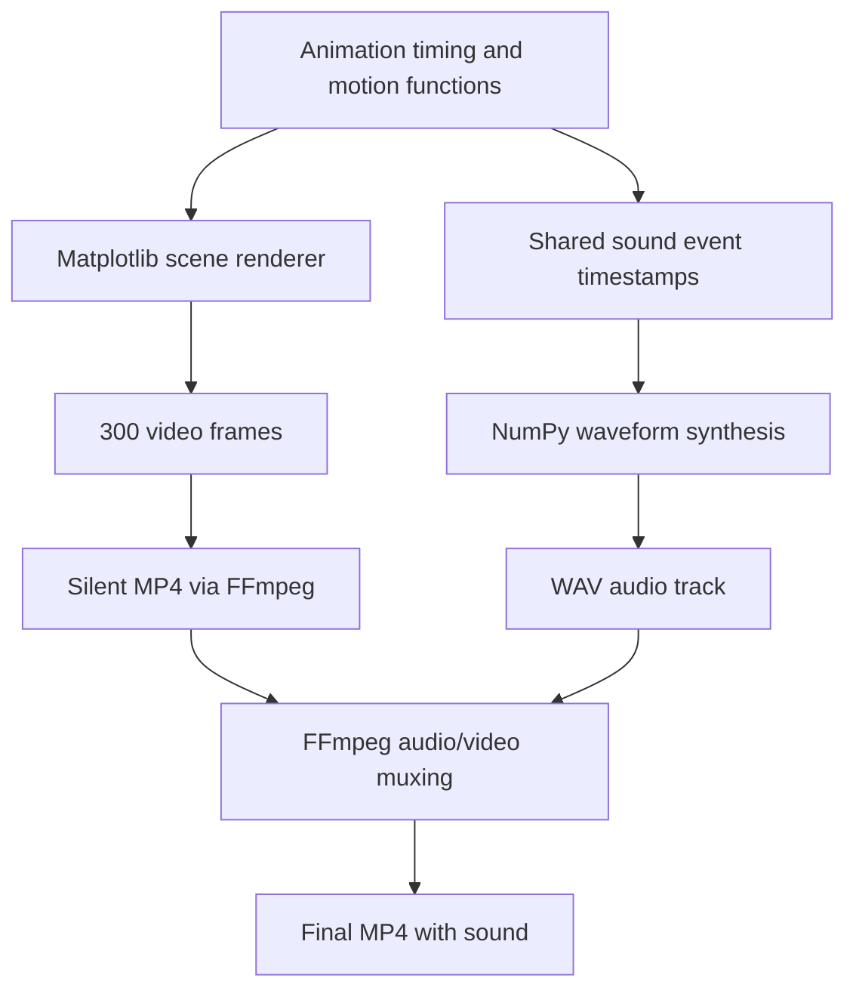

# 🏀 Stickman Basketball Animation

**A code-driven 2D basketball animation with procedurally synthesized sound effects.**


## ✨ Overview

I created this personal project out of curiosity about **how a video can be generated entirely through code**. Rather than drawing each frame manually or editing a conventional animation timeline, I wanted to understand how mathematical functions, coordinates, and time can produce a moving scene—and how audio can be generated and synchronized with it.

The result is a short basketball animation set on a nighttime court. A stick figure dribbles the ball, prepares a jump shot, scores, and celebrates. The background, character motion, basketball trajectory, and sound effects are generated programmatically.

## 🎬 Animation Preview


**Watch the full video:** [🔊 With synthesized sound](stickman_basketball_sound.mp4) · [🔇 Silent version](stickman_basketball.mp4)

> The GIF is a lightweight visual preview and contains no audio. Open the MP4 with sound to hear the generated effects.

### At a Glance

| Property | Value |
| --- | --- |
| Animation length | 10 seconds |
| Resolution | 1280 × 720 (16:9) |
| Frame rate | 30 FPS |
| Total frames | 300 |
| Audio sample rate | 44,100 Hz |
| Audio format | Mono, 16-bit PCM WAV before video muxing |

## 🌟 Key Features

- **Procedural character animation:** Body and limb positions are calculated for each point in time instead of being hand-animated frame by frame.
- **Keyframe interpolation:** Smooth easing creates transitions between dribbling, crouching, shooting, landing, and celebrating.
- **Two-link inverse kinematics:** Elbow and knee positions are determined from limb lengths and target hand/foot coordinates.
- **Physics-inspired basketball motion:** The shot follows a gravity-based parabolic path; subsequent bounces are simulated with reduced velocity after impact.
- **Dynamic visual details:** A spinning basketball, squash-on-impact effect, deforming net, movement shadows, shot trail, and `SCORE!` celebration graphic.
- **Procedural sound design:** Ball bounces, net swish, landing sounds, and an arcade-style victory jingle are synthesized without external audio samples.
- **Timeline-based synchronization:** The audio script imports timing events from the animation script to align sound with action.

## 🧰 Tech Stack

| Technology | Role |
| --- | --- |
| **Python** | Animation logic, math, simulation, and audio-processing workflow |
| **NumPy** | Numerical operations, signal generation, and sample arrays |
| **Matplotlib** | 2D scene rendering and frame-by-frame animation |
| **Pillow** | GIF export fallback when FFmpeg is unavailable |
| **Python standard library** | Mathematics, WAV file writing, file operations, and subprocess execution |
| **FFmpeg** | MP4 encoding and merging the generated audio with the video |

## ⚙️ How It Works

### 1. Represent motion as a function of time

The central idea is simple: **given a time `t`, calculate what the scene should look like at that instant**.

The animation uses named timing events for dribbling, shooting, landing, scoring, and celebrating. Smoothstep easing makes transitions more natural:

```text
smoothstep(u) = u²(3 − 2u),   where 0 ≤ u ≤ 1
```

For arms and legs, a two-link inverse-kinematics calculation uses the desired hand or foot position and fixed segment lengths to locate the elbow or knee.

### 2. Simulate the basketball

After release, the ball follows a projectile trajectory:

```text
x(t) = x₀ + vₓt
y(t) = y₀ + vᵧt − ½gt²
```

The release velocity is chosen so the ball reaches the hoop at the intended time. After passing through the rim, the program simulates falling and bouncing in small time steps, applying a velocity-reduction factor at each impact.

### 3. Render the animation

Matplotlib draws the static night-court background once. For each frame, it updates the stick figure, basketball, shadows, net, and visual effects. `FuncAnimation` renders **300 frames at 30 FPS**.

With FFmpeg installed, the result is `stickman_basketball.mp4`. Otherwise, the animation script exports a GIF.

### 4. Synthesize sound from numerical signals

The sound script constructs waveforms with NumPy at **44,100 samples per second**. It combines oscillators, filtered noise, frequency changes, and amplitude envelopes to model different effects:

- **Bounce:** a low-frequency thump, hollow resonance, and a short impact transient.
- **Net swish:** filtered noise shaped to resemble the ball passing through the net.
- **Victory jingle:** an ascending sequence of electronically synthesized notes followed by a chord.

Each waveform is placed on a shared audio timeline. The result is saved as `stickman_basketball.wav` and, when FFmpeg and the silent MP4 are available, muxed into `stickman_basketball_sound.mp4`.

### Rendering Pipeline



## 📁 Project Structure

```text
stickman_animation/
├── stickman_basketball.py          # Animation, movement, physics, rendering
├── Make sound.py                   # Procedural audio synthesis and video muxing
├── stickman_basketball.mp4         # Silent video output
├── stickman_basketball_sound.mp4   # Video with synthesized sound
├── README.md                       # Project documentation
└── assets/
    └── stickman_preview.gif       # Inline README preview
```

The scripts also generate `stickman_basketball.wav` when you run the audio step. If FFmpeg is not available, the animation script generates `stickman_basketball.gif` instead of MP4.

## 🚀 Getting Started

### Prerequisites

- Python 3
- Python packages: `numpy`, `matplotlib`, `pillow`
- **FFmpeg** installed and available on your system's `PATH` for MP4 export and audio/video merging

### 1. Clone the repository

```bash
git clone https://github.com/InfiniteLoop-dev/stickman_animation.git
cd stickman_animation
```

### 2. Create a virtual environment (recommended)

**Windows PowerShell:**

```powershell
py -m venv .venv
.\.venv\Scripts\Activate.ps1
```

**macOS / Linux:**

```bash
python3 -m venv .venv
source .venv/bin/activate
```

### 3. Install Python dependencies

```bash
python -m pip install numpy matplotlib pillow
```

To check whether FFmpeg is available:

```bash
ffmpeg -version
```

### 4. Generate the silent animation

```bash
python stickman_basketball.py
```

Creates `stickman_basketball.mp4` if FFmpeg is installed, or `stickman_basketball.gif` otherwise.

### 5. Generate the audio and combined video

```bash
python "Make sound.py"
```

Creates `stickman_basketball.wav`. If FFmpeg and `stickman_basketball.mp4` are present, it also creates `stickman_basketball_sound.mp4`.

> **Filename note:** The audio script in this repository is named **`Make sound.py`** (including the space and capitalization). Keep the quotation marks in the command above.

## 🧠 What I Learned

This personal experiment helped me explore the connection between several areas of programming:

1. **Animation as computation:** A video can be built by evaluating a scene at successive timestamps rather than manually drawing every frame.
2. **Mathematics in motion:** Interpolation, trigonometry, inverse kinematics, and projectile equations can create expressive movement.
3. **Digital sound as data:** Audio can be synthesized from mathematical waveforms and manipulated as numerical arrays.
4. **Multimedia pipelines:** Animation rendering, audio generation, and final encoding are separate steps that can be connected through shared timing information.

The most interesting takeaway was seeing how **a few mathematical models can become a complete audiovisual scene**.

## 👤 Author

Created as a personal learning project by **[InfiniteLoop-dev](https://github.com/InfiniteLoop-dev)**.
